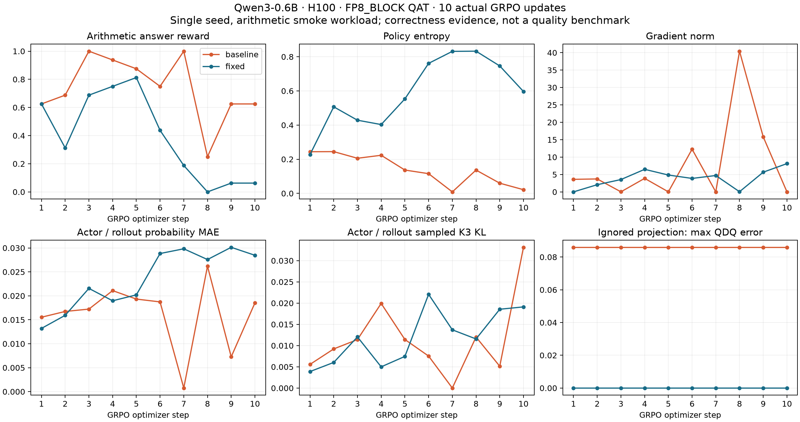

# ModelOpt QAT module-ignore validation on H100

Actual baseline and fixed runs of Qwen3-0.6B, with 10 GRPO optimizer updates per arm. These artifacts support the module-ignore correctness fix; they are not a model-quality benchmark.



## Results

| Check | Baseline | Fixed |
| --- | --- | --- |
| Successful GRPO updates | 10 | 10 |
| Enabled quantizers in 28 ignored attention output projections | 56/56 | 0/56 |
| First ignored projection input/weight max QDQ error, every step | 0.0859375 | 0 |
| Changed first-projection parameter hash after each update | 10/10 | 10/10 |
| Exported BF16 weight exactly equals live vLLM weight | 11/11 | 11/11 |
| Mean arithmetic reward | 0.7375 | 0.39375 |
| Mean sampled actor/rollout K3 KL | 0.0115391 | 0.0119434 |

The 11 refits include initialization and all 10 updates. Equality was checked with `torch.equal` on captured first-layer `o_proj` tensors (BF16, 1024 x 2048), not inferred from configuration. Refit equality already holds in the baseline: the bug is that actor-side fake quantization remains enabled even when rollout deliberately keeps the corresponding projection in BF16.

The reward and whole-model discrepancy curves do not establish an improvement. Both runs use seed 7 and the same configuration/data, but sampled trajectories differ; these are not paired fixed-token quality measurements. Some batches have zero GRPO advantages; a 0.001 entropy coefficient still produces a real nonzero gradient and changed parameters on every step. This is one GPU, one seed, one small dense model, and 10 updates. MXFP8 is covered by unit tests, not this FP8 end-to-end run. Multi-GPU and Qwen3.5/GDN behavior were not validated.

## Configuration and provenance

- Baseline: `f2923cbf154731918b1e36db8c567433f349fede` in verl-project/verl.
- Fix: `474cf8538eae74199d48cbdbda09c70dd4181cf3` in LZC-BELIEVER/verl.
- One NVIDIA H100 80GB, TP=PP=CP=EP=1; actor Megatron + ModelOpt FP8 QAT, rollout vLLM FP8_BLOCK.
- Actor ignore: `["lm_head", "*mlp.gate", "*self_attention.linear_proj"]`.
- Rollout ignore: `["re:.*self_attn\\.o_proj$"]`.
- Batch: 8 prompts, 2 samples per prompt, response length 64; learning rate 1e-5, entropy coefficient 0.001.
- Packed THD input (`use_remove_padding=True`) with **`use_arbitrary_attention_mask=False` explicitly set** in the Megatron transformer override. This avoids the ModelOpt layer-spec arbitrary-mask default; causal attention is required for this experiment.
- Deterministic two-digit multiplication/addition/subtraction workload, 80 training prompts, 16 held-out prompts. Reward compares the last numeric answer exactly; held-out evaluation is not run.
- Runtime versions and checkpoint SHA256 hashes are in [environment.json](environment.json). The environment uses the upstream lock, CUDA 13.0, and a private glibc 2.39/C++ runtime. A compatible Ubuntu 24.04 CUDA 13.0 environment avoids that host-runtime workaround.

`runs/` contains raw scalar metrics, read-only hook event logs, exit status, source hashes, and the exact-refit verification results. Raw tensor snapshots remain in the original local experiment directories; the reproduction scripts capture new snapshots for independent verification. The hooks observe quantizer states, input/output error, optimizer gradients/weight hashes, exported weights, actual post-refit vLLM weights, and log probabilities. They do not modify model tensors or the optimizer.

## Reproduce

Use an environment matching `environment.json` and the baseline's `uv.lock`. Set `PYTHON` to its Python executable, `CUDA_HOME` to a CUDA 13.0 toolkit, and `MODEL_PATH` to a local Qwen3-0.6B checkpoint. Clone both source branches into separate directories, and run the following from this evidence checkout. Use fresh output directories/tags for repeated experiments.

```bash
# DATA_PYTHON needs pandas and pyarrow; PLOT_PYTHON needs matplotlib.
"$DATA_PYTHON" scripts/make_data.py
"$PYTHON" scripts/run_training.py --arm baseline --steps 10 --tag run \
  --repo "$BASELINE_REPO" --model-path "$MODEL_PATH" --cuda-home "$CUDA_HOME" --gpu 0
"$PYTHON" scripts/run_training.py --arm fixed --steps 10 --tag run \
  --repo "$FIXED_REPO" --model-path "$MODEL_PATH" --cuda-home "$CUDA_HOME" --gpu 0
"$PYTHON" scripts/verify_refits.py scripts/baseline-run --steps 10
"$PYTHON" scripts/verify_refits.py scripts/fixed-run --steps 10
"$PLOT_PYTHON" scripts/plot_results.py --runs-root scripts --output reproduced-results
```

Regenerate the published plot from the published scalar/event records without a GPU:

```bash
"$PLOT_PYTHON" scripts/plot_results.py --runs-root runs --output regenerated-results
```

Upload completed records with SwanLab 0.10.2 (credential read from a file; not stored by the script):

```bash
"$TRACKING_PYTHON" scripts/upload_swanlab.py --results . --key-file "$SWANLAB_KEY_FILE"
```

## Regression validation

`pytest -q tests/utils/test_modelopt_mxfp8_on_cpu.py`: **34 passed**, with compressed-tensors 0.17.0, and again with 0.18.0. Applying the new tests to the unmodified baseline and selecting `-k ignore`: **6 failed, 11 passed, 17 deselected**. All 14 pre-commit hooks passed on the fixed source. The PR explicitly runs this test file in the GPU dependency slice because the CPU slice lacks ModelOpt/compressed-tensors and the GPU suite normally excludes files ending in `_on_cpu.py`.

AI assistance was used for the patch, tests, experiment instrumentation, and this report.
